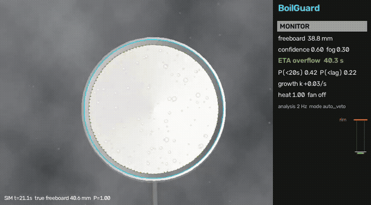
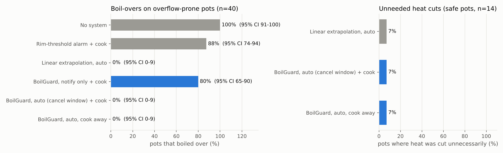
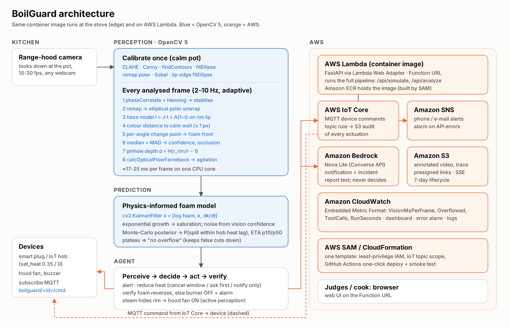
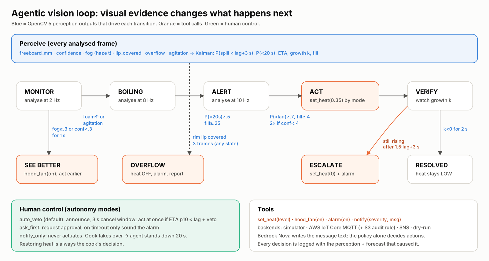

# BoilGuard 🍲🛡️

**See it coming. Turn it down.** A range-hood camera that predicts a pot boiling over and lowers the
heat *before* it spills — built on **OpenCV 5** and **AWS**.

> OpenCV AI Competition 2026, powered by AWS · Overall + **Agentic Vision** path
> Shermaine Yap Shi Min · Asia Pacific University of Technology and Innovation, Malaysia

**Live app:** https://5a25kqeayc5ki2btob2zvzuhhq0gocaz.lambda-url.us-east-1.on.aws/ · **Video:** https://youtu.be/Amshg0SkqNw · **Report:** [docs/TECHNICAL_REPORT.md](docs/TECHNICAL_REPORT.md) · Side-by-side demo: [docs/media/demo_side_by_side.mp4](docs/media/demo_side_by_side.mp4)



## Why

Cooking is the leading cause of home fires and **unattended cooking is by far the leading factor**
(NFPA: 49% of US home fires, ~158,400 a year). A boil-over is the everyday version: milk or pasta
water foams over in seconds, puts out gas flames, bakes onto glass hobs and scalds. Stoves also have
**heat lag** — foam keeps rising for 1-8 s after you turn the knob — so a warning that comes when
the foam reaches the rim is already too late.

BoilGuard watches the pot from above, measures how far the foam is below the rim in millimetres,
**forecasts when it will spill with a physics-informed model**, and acts early enough to beat the
heat lag: alert → lower heat → verify from video → escalate if needed.

## Results (held-out simulated test set)

| Policy | Boil-overs (overflow-prone pots) | Unneeded heat cuts (clearly-safe pots) | Heat cuts on near-misses | Warnings on clearly-safe pots | Median warning before spill (s) |
|---|---|---|---|---|---|
| No system | 100% (95% CI 91-100%) | — | — | — | — |
| Rim-threshold alarm + cook | 88% (95% CI 74-94%) | — | — | 50% | 3.3 |
| Linear extrapolation, auto | 0% (95% CI 0-9%) | 7% | 83% | 7% | 4.7 |
| BoilGuard, notify only + cook | 80% (95% CI 65-90%) | — | — | 36% | 4.5 |
| BoilGuard, auto (cancel window) + cook | 0% (95% CI 0-9%) | 7% | 33% | 36% | 4.5 |
| BoilGuard, auto, cook away | 0% (95% CI 0-9%) | 7% | 33% | 36% | 4.5 |

Test set: 40 overflow-prone, 14 clearly-safe and 6 near-miss scenes (foam peaks at 70-100% of the rim). Heat cuts on near-misses are arguably correct caution.

* BoilGuard in auto mode **prevented all 40 boil-overs** (cook nearby or away) with 1/14 unnecessary heat cuts.
* **A warning alone fails**: with a cook reacting in ~6 s, 80-88% of pots still spill — heat lag + reaction time is too long. Hence an agent that acts.
* Silent heads-up a median **8.3 s** before the spill; warning 4.5 s; forecast error 1.2 s at 5 s out.
* Freeboard error median **3.1 mm**; rim found within 3 px in 57/60 scenes; **18.6 ms/frame** on one CPU core.



See the report for the forecast-error curve, failure cases and limitations.

## How it works



| | |
|---|---|
| **Perception (OpenCV 5)** | rim: CLAHE + Canny + `findContours` + `fitEllipse`, refined on the bright lip · stabilise: `phaseCorrelate` · unwrap: elliptical-polar `remap` · steam: atmospheric-scattering (dehazing) model fitted on the rim lip · foam front: per-angle change point against the static inner wall · depth: pinhole geometry · boiling onset: `calcOpticalFlowFarneback` |
| **Prediction** | `cv2.KalmanFilter` on log-foam with growth rate and its change (exponential growth → saturation) · Monte-Carlo posterior → P(spill within the hob's heat lag), ETA |
| **Agent** | perceive → decide → act → **verify** → escalate; hood fan for steam (active perception); 3 human-control modes; adaptive 2-10 Hz analysis |
| **AWS** | Lambda container + Function URL (FastAPI via Lambda Web Adapter) · IoT Core MQTT device commands + S3 audit rule · SNS alerts · Bedrock (Nova Lite) messages & incident reports · S3 evidence · CloudWatch EMF metrics, dashboard, alarm · SAM + GitHub Actions |



Full details: **[docs/TECHNICAL_REPORT.md](docs/TECHNICAL_REPORT.md)**.

## Run it locally (2 minutes)

```bash
git clone https://github.com/ShermaineYap/opencv-ai-hack && cd opencv-ai-hack
python -m venv .venv && source .venv/bin/activate      # Windows: .venv\Scripts\activate
pip install -r requirements-dev.txt                   # Python 3.13, OpenCV 5.0.0
pytest -q                                             # 15 tests, ~1 min
uvicorn app.server:app --port 8080                    # open http://localhost:8080
```

Command line:

```bash
python -m boilguard.cli simulate --seed 7 --liquid milk --heater ceramic --out runs/demo   # annotated video + trace
python -m boilguard.cli analyze my_pot.mp4 --cam-height 450 --heater induction            # your own top-down clip
```

Reproduce the evaluation (≈45 min on 2 cores):

```bash
python eval/tune.py --record     # dev set only: choose thresholds (already done, results/dev)
python eval/run_eval.py          # held-out test set, 60 scenes x 6 policies + open loop
python eval/report.py            # results/metrics.json, eval_table.md, figures
```

## Deploy to AWS (one click)

1. Fork or use this repo → **Settings → Secrets and variables → Actions** → add
   `AWS_ACCESS_KEY_ID` and `AWS_SECRET_ACCESS_KEY` (an IAM user allowed to deploy CloudFormation,
   Lambda, ECR, S3, IoT, SNS, CloudWatch, IAM roles).
2. **Actions → Deploy to AWS → Run workflow** (region `us-east-1`, optional alert e-mail).
3. The job builds the container, deploys `aws/template.yaml`, smoke-tests `/health` and
   `/api/simulate`, and prints the **App URL** in the run summary.

Or from a machine with Docker + SAM CLI: `./scripts/deploy.sh us-east-1 you@example.com`.

Watch the agent's device commands live: AWS console → IoT Core → MQTT test client → subscribe to
`boilguard/+/cmd`, then run a scenario with *Mirror commands to AWS IoT Core* ticked.
Bedrock: the template uses `us.amazon.nova-lite-v1:0`; if the account has no access, messages fall
back to templates automatically.

## Repository map

```
boilguard/vision/rim.py       rim ellipse detection + lip refinement
boilguard/vision/surface.py   stabilisation, haze model, foam front, depth, confidence
boilguard/predict.py          physics-informed Kalman forecaster (+ baselines)
boilguard/agent/              policy (state machine), tools (sim / AWS IoT / SNS), Bedrock narrator
boilguard/sim.py              physically grounded boil-over simulator = benchmark + closed-loop env
boilguard/monitor.py          session loop for simulator, video files (and cli.py for webcams)
app/                          FastAPI service + web UI
aws/template.yaml             SAM: Lambda, Function URL, S3, IoT rule, SNS, Bedrock IAM, CloudWatch
eval/                         tuning (dev), evaluation (test), report + figures
results/                      metrics.json, eval_table.md, figures, dev recordings
```

## Honest limitations

All quantitative results are on a **physically simulated** benchmark (exact ground truth for the
spill time; random liquids, hobs, steam, hands, tilt, shake, noise). Real-footage validation on real
stoves is the next step (`data/real/README.md` describes the protocol). Automatic heat control must
be validated and certified before anyone relies on it; BoilGuard assists, it does not replace
attention or smoke alarms. See the report for failure cases.

## License

MIT — see `LICENSE`.
