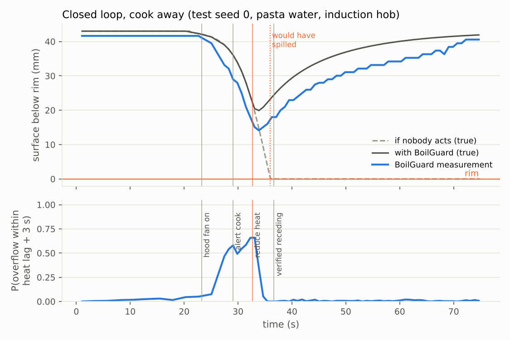
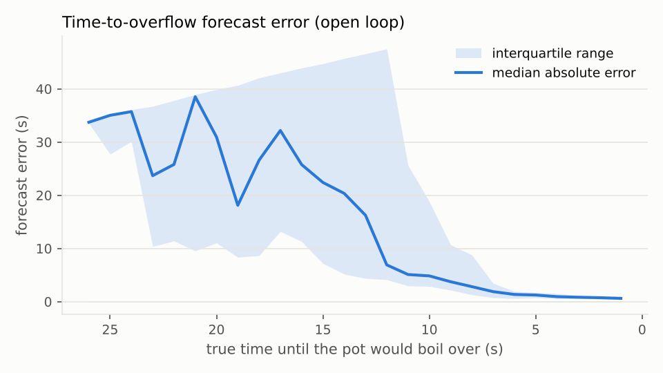
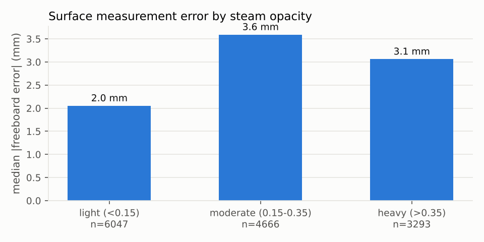

# BoilGuard: physics-informed boil-over prediction and prevention with OpenCV 5 and AWS

**OpenCV AI Competition 2026 (powered by AWS) — technical report**
Author: Shermaine Yap Shi Min, Asia Pacific University of Technology and Innovation (APU), Malaysia
Code: https://github.com/ShermaineYap/opencv-ai-hack · Paths: Overall + Agentic Vision Award

---

## 1. Problem

Cooking is the leading cause of home fires. In the US, NFPA attributes nearly half (49%) of home
fires to cooking equipment, about 158,400 per year in 2017-2021, with 470 deaths, 4,150 injuries
and $1.15 billion of direct damage; **unattended cooking is by far the leading factor** [1]. In
Malaysia, the Fire and Rescue Department (Bomba) summarises the cause of most home fires as
"3L": *lalai, lupa, leka* — negligence, forgetting, distraction [2].

A boil-over is the everyday, high-frequency version of the same failure. Milk, pasta water,
rice, curry and porridge foam over within seconds of the boil; the spill puts out gas flames
(leaving gas flowing), bakes onto ceramic and induction glass, trips induction hobs, and
scalds. Existing smart-stove features are **reactive** (detect a spill or smoke afterwards) or
**timer-based**. Nothing watches the pot and predicts *when* it will spill.

The timing matters because stoves have **thermal inertia**: after the heat is turned down,
foam keeps rising for about 1-2 s on induction, 4-6 s on ceramic and 5-8 s on electric coils.
A warning has to come before that lag runs out, or it is useless.

**Users.** People who cook while multitasking (parents, students, shift workers), older adults
with memory issues and their carers, and appliance makers: camera-equipped hoods already exist
(e.g. GE's Kitchen Hub streams a downward view of the cooktop [4]), so the hardware is in kitchens.

**Prior art.** Patents describe detecting that water *is boiling* [5] or monitoring boiling for
cooking assistance [6], and hoods that react to smoke or heat. BoilGuard's difference is
(a) predicting *when* a foaming pot will spill, with calibrated uncertainty, early enough to beat
the hob's heat lag, and (b) closing the loop: act, verify from video, escalate. **Benefit:** fewer spills, burns and gas-flame
outages; less cleaning; peace of mind to step away briefly.

## 2. What BoilGuard does

A camera in the range hood looks down at the pot. BoilGuard

1. **finds the pot rim** and measures how far the liquid/foam surface is below it, in millimetres;
2. **predicts** the probability that the pot will spill *within the hob's heat lag* and the
   expected time to overflow, using a physics-informed foam-growth model;
3. **acts**: alerts the cook, lowers the heat early enough to beat the lag (with a cancel window,
   approval or notify-only mode), then **verifies from the video** that foam growth reversed and
   escalates to burner OFF if not; when steam hides the rim it turns the **hood fan** on to see better;
4. **explains**: Amazon Bedrock writes the phone notification and an incident report from the
   numbers.

## 3. Architecture

The same Python package and container image run at the stove (edge) and on AWS. On AWS, an
**AWS Lambda** container (FastAPI via the Lambda Web Adapter, behind a Function URL) runs the
full pipeline for the web demo and for uploaded clips; **AWS IoT Core** carries device commands
over MQTT (`boilguard/<device>/cmd`) and an IoT topic rule archives every actuation to **Amazon S3**
for audit; **Amazon SNS** delivers alerts; **Amazon Bedrock** (Nova Lite, Converse API) writes
messages; **Amazon CloudWatch** receives metrics via Embedded Metric Format, a dashboard and an
error alarm; everything is one **AWS SAM** template deployed by a GitHub Actions workflow.

Design choice: the safety loop does not depend on the cloud. Vision, prediction and the policy are
deterministic and run in ~20 ms per analysed frame on one CPU core, so they can run on the hood's
own processor; the cloud adds remote actuation, notifications, audit, narration and observability.

## 4. OpenCV 5 implementation

All perception is classical OpenCV 5 (`opencv-python-headless==5.0.0.93`); no training data is
needed, which matters for a safety product that must work on any pot on day one.

| Step | OpenCV 5 functions | Why |
|---|---|---|
| Rim detection (once) | median of 15 frames, `createCLAHE`, `GaussianBlur`, `Canny`, `dilate`, `findContours`, `fitEllipse`, `HoughCircles` fallback | Candidate ellipses scored by edge support (360 samples), size and roundness; the largest well-supported one is the pot's outer edge. |
| Spill-line refinement | `remap` (elliptical polar), `Sobel`, per-angle sub-pixel peaks, `fitEllipse` + trimming | Hood lights sit next to the camera, so the up-facing rim lip is a thin bright ridge. Its inner edge is where liquid spills. |
| Stabilisation | `phaseCorrelate` + `createHanningWindow` on a rim-only annulus | Cancels hood vibration; hands or spoons crossing the rim give weak/large peaks and are rejected. |
| Unwrap | `remap` with precomputed elliptical-polar maps | A rising surface becomes a front moving outward along each row. |
| Steam | per-angle atmospheric scattering model I = J·t + A(1−t) fitted on the lip + stove band; `medianBlur`, `GaussianBlur` | Steam is haze. Inverting the dehazing model restores the wall's appearance; 1 − t is a steam index. |
| Foam front | `subtract`, `multiply`, `transform`, `sqrt` (colour distance, ±1 px tolerant), vectorised change point via cumulative sums | The inner wall is static background: per angle, find where "differs from the calm wall" becomes "matches it". |
| Robust estimate | median and MAD over 360 angles; lip-coverage test | Occluders cover a sector, foam covers all angles; overflow = rim lip covered *and* front at the rim. |
| Depth | pinhole model: r_surface / r_rim = H / (H + d) | Converts the front's radius to millimetres below the rim using the camera height. |
| Boiling onset | `calcOpticalFlowFarneback` on the liquid region | Agitation flags boiling before foam forms. |
| Overlay | `ellipse`, `circle`, `putText`, H.264 via ffmpeg | Annotated video for the cook and the judges. |

## 5. Prediction: physics-informed Kalman filter

Protein- and starch-stabilised foam grows **exponentially** at onset (bubble films trap gas that
nucleates more bubbles) and then **saturates** or collapses as drainage catches up; with heater
power P_e, dh/dt = P_e g h (1 − h/h_max) − λ (1 − P_e) h. In log space this is a growth rate
k(t) that drifts, so BoilGuard tracks x = [log(foam + h0), k, dk/dt] with `cv2.KalmanFilter`,
rebuilding the transition matrix for every variable time step. Measurement noise comes from the
vision confidence and steam index, with a 4-σ innovation gate.

The forecast is probabilistic: 400 samples from the posterior are propagated with the
kinematic model (growth acceleration is not extrapolated upward — a physical prior) and each
crossing time of the rim is solved in closed form. This gives P(spill within lag + 3 s),
P(spill within 20 s) and ETA percentiles. A plateau predicts "no overflow", which is what keeps
heat cuts away from simmering pots.

## 6. Agent (perception → decision → action → verification)

The decision policy is deterministic and auditable; every decision is logged with the perception
and forecast that caused it (see the trace in the web app and `result.json`). Visual evidence
changes the next action in five ways: (1) boiling onset raises the analysis rate from 2 Hz to
8-10 Hz (active perception and 3-4× less compute while idle); (2) steam or low confidence turns
the hood fan on and makes the policy act earlier; (3) a rising P(spill within 20 s) alerts the
cook; (4) a high P(spill within the heat lag) lowers the heat, with the human-control mode deciding
how; (5) after acting, the agent checks from video that the growth rate turned negative, and
escalates to burner OFF + alarm if it did not. Operating thresholds (P ≥ 0.7, foam ≥ 40% of the
calm freeboard; two consecutive frames when confidence < 0.4) were chosen on a separate dev set
by offline replay (`eval/tune.py`), never on the test set.

Amazon Bedrock (Nova Lite via the Converse API) writes the notification and the end-of-session
report from structured numbers only; it is never in the safety path, has a 4 s timeout and a
template fallback.

## 7. AWS deployment

Everything is one AWS SAM template, `aws/template.yaml`, deployed by `.github/workflows/deploy.yml`
(build the container image → push to Amazon ECR → CloudFormation → smoke-test the live URL).

| Service | Role in BoilGuard |
|---|---|
| **AWS Lambda** (container image, 3 GB, 180 s) + **Function URL** | Runs the unmodified FastAPI app through the AWS Lambda Web Adapter: `/api/simulate` runs a 60 s closed-loop boil with full vision + Kalman + agent and returns an H.264 annotated video and the decision trace; `/api/analyze` processes an uploaded clip. The same image runs locally with `uvicorn`. |
| **Amazon ECR** | Stores the image (created by `sam deploy --resolve-image-repos`). |
| **AWS IoT Core** | Device command channel: the agent publishes `set_heat`, `hood_fan`, `alarm`, `notify` to `boilguard/<device>/cmd` (QoS 1). A smart plug, IoT hob or ESP32 relay subscribes. An **IoT topic rule** writes every command to S3 (`device-audit/`) — a tamper-evident audit trail of every actuation. |
| **Amazon SNS** | Phone / e-mail alerts for warnings and escalations; also receives the CloudWatch error alarm. |
| **Amazon Bedrock** (Amazon Nova Lite via the Converse API, cross-region profile `us.amazon.nova-lite-v1:0`) | Turns the structured evidence into the notification text and the incident report. Not in the safety path: 4 s timeout, call budget, template fallback. |
| **Amazon S3** | Annotated videos and traces (SSE, public access blocked, 7-day lifecycle, 1-hour presigned URLs) and the device audit log (30 days). |
| **Amazon CloudWatch** | Embedded Metric Format log lines create `BoilGuard/VisionMsPerFrame`, `RunSeconds`, `Overflowed`, `ToolCalls` without API calls; a dashboard, a Logs Insights widget of recent runs, an error alarm, 14-day log retention. |
| **IAM** | Least privilege: S3 CRUD on the one bucket, `iot:Publish` only on `topic/boilguard/*`, `bedrock:Converse/InvokeModel`, SNS publish to one topic. Public URL permission scoped with `lambda:InvokedViaFunctionUrl` [3]. |

**Cost** for a judging period is a few US dollars: Lambda bills per request (a 60 s scenario takes
~20-35 s of a 3 GB function), Bedrock Nova Lite costs fractions of a cent per message, S3 objects
expire after 7 days. **Edge vs cloud:** at a real stove the vision and policy run locally (18.6 ms per
analysed frame, ~4 frames/s on average thanks to adaptive sampling), and the cloud provides
actuation over MQTT, notifications, audit, narration and fleet observability.

## 8. Evaluation

**Why simulation.** Real boil-over footage with a known spill time is not available (stock sites
have almost none, and using unlicensed video breaks the rules), and filming dozens of boil-overs
safely was not possible within the competition. I therefore built `boilguard/sim.py`, a physically
grounded renderer and closed-loop environment: logistic foam growth driven by heater power with
thermal lag (induction 0.8-1.8 s, ceramic 3.5-6 s, coil 5-8 s), drainage when power drops, pinhole
camera geometry, steam (moving haze), hands and spoons crossing the pot, camera tilt up to 14°,
shake up to 2 px, sensor noise and JPEG compression, four liquids. Because it is closed-loop, a
policy's actions change the physics, so we can measure *prevented* boil-overs, not just accuracy.
The vision pipeline never sees ground truth.

**Protocol.** Thresholds were tuned on a **dev set** (40 scenes, seeds 2000+/3000+) by offline
replay (`eval/tune.py`). The **test set** is 60 different scenes (seeds 0-39 overflow-prone, 500-519
safe; a quarter "hard" with more steam, occlusion and shake), evaluated once per policy with the
same scenes and the same simulated cook (nearby in ~60% of scenes, reaction time lognormal with
median 6 s, who turns the heat down when alerted). Baselines: no system; a rim-threshold alarm
(what a simple boil-over sensor does) with the cook; linear extrapolation of the freeboard with
automatic heat reduction (a strong, simple predictor).

**Results.**

| Policy | Boil-overs (overflow-prone pots) | Unneeded heat cuts (clearly-safe pots) | Heat cuts on near-misses | Warnings on clearly-safe pots | Median warning before spill (s) |
|---|---|---|---|---|---|
| No system | 100% (95% CI 91-100%) | — | — | — | — |
| Rim-threshold alarm + cook | 88% (95% CI 74-94%) | — | — | 50% | 3.3 |
| Linear extrapolation, auto | 0% (95% CI 0-9%) | 7% | 83% | 7% | 4.7 |
| BoilGuard, notify only + cook | 80% (95% CI 65-90%) | — | — | 36% | 4.5 |
| BoilGuard, auto (cancel window) + cook | 0% (95% CI 0-9%) | 7% | 33% | 36% | 4.5 |
| BoilGuard, auto, cook away | 0% (95% CI 0-9%) | 7% | 33% | 36% | 4.5 |

Test set: 40 overflow-prone, 14 clearly-safe and 6 near-miss scenes (foam peaks at 70-100% of the rim). Heat cuts on near-misses are arguably correct caution.

* **BoilGuard in auto mode prevented all 40 boil-overs**, whether the cook was nearby or away,
  cutting heat unnecessarily on 1 of 14 clearly-safe pots (milk under very heavy steam whose foam
  peaked at 68% of the rim — a borderline case).
* **A warning alone is not enough.** With the cook reacting in ~6 s, 80% of pots still spilled in
  notify-only mode and 88% with a rim-threshold alarm. Heat lag plus human reaction time is longer
  than the time between "visible danger" and spill. This is the core argument for an agent that acts.
* **Versus linear extrapolation**, which also prevented every spill in simulation: BoilGuard cut
  heat on near-misses (foam peaking at 70-100% of the rim) half as often (33% vs 83%), and gives a
  silent heads-up a median **8.3 s** before the spill in addition to the warning (4.5 s).
  Linear extrapolation sent fewer warnings on safe pots (7% vs 36%) — BoilGuard's 20-second
  look-ahead is deliberately cautious, and this is the main cost of the current operating point.
* **Forecast accuracy** (open loop, figure below): median ETA error 0.8 s at 3 s before the spill,
  1.2 s at 5 s, 2.8 s at 8 s, 4.8 s at 10 s. The pessimistic 10th-percentile ETA was earlier than the
  true spill time in **99.7%** of predictions (conservative by design). More than ~12 s before a
  spill the foam is not yet visible and the forecast correctly says "not yet", which this plot
  counts as a large error.
* **Perception** over 14,006 frames: freeboard error median **3.1 mm** (MAE 4.0 mm, 90th
  percentile 6.5 mm), biased by −3.8 mm (foam reported slightly closer to the rim: the safe
  direction). By liquid: pasta water 2.0 mm, milk 2.6 mm, coconut curry 3.3 mm, tomato soup 5.9 mm.
  By steam: light 2.0 mm, moderate 3.6 mm, heavy 3.1 mm. The rim was localised within 3 px in
  **57/60** scenes (median centre error 0.39 px, radius 1.46 px).
* **Agent behaviour.** Steam triggered the hood fan (active perception) in 28 of 60 scenes. The
  escalation path (burner off) was never needed on the test set; it is covered by unit tests.
  On average 4.7 tool calls per session.
* **Compute.** 18.6 ms per analysed frame (p95 25 ms) on one CPU core; adaptive sampling averaged
  4.0 analyses per second instead of a fixed 8, halving compute while idle.

Every run's summary is in `results/summary.csv`; aggregated metrics and the failure list in
`results/metrics.json`.

## 9. Limitations

* **Simulation, not real stoves.** All numbers are on a physically grounded but synthetic benchmark.
  Real foam (milk skin, starch, rolling boils without foam), real reflections and real hood
  lighting will differ. A real-stove study (`data/real/README.md`) is the next step. The simulator
  shares assumptions with the forecaster (logistic growth), which favours model-based prediction;
  the linear baseline doing equally well on prevention is a reminder of that.
* **Rim detection on dark liquids.** The 3 rim failures (of 60) were tomato soup / curry where the
  calm liquid edge was mistaken for the rim, giving an implausibly small calm freeboard (3-7 mm).
  The system flags this ("please confirm the pot outline") but the web demo has no rim-editing UI yet.
* **Dark-liquid accuracy.** Tomato soup error (5.9 mm) is twice milk's; low contrast between soup
  and steel. A colour-specific background model or a small learned edge detector would help.
* **Warnings on safe pots (36%).** The 20-second look-ahead warns on some simmers that later
  plateau. The tuned operating point favours never missing a spill; a per-user sensitivity setting
  is the obvious product fix.
* **Camera geometry.** The depth formula needs the camera height above the rim (entered once);
  a 10% error scales millimetres by ~10% but does not move the moment the foam reaches the rim.
* **Actuation.** Only electric/induction hobs can be controlled through a smart plug or IoT hob.
  For gas, BoilGuard can only alert and sound the alarm (and the hood fan). Any automatic heat
  control needs appliance-level safety certification.
* **Scale of the evaluation.** 60 test scenes give wide confidence intervals (0% overflow has a 95%
  CI of 0-9%).

## 10. Responsible use

* **Privacy by design.** Only the pot region is analysed; an optional privacy mask blurs
  everything outside 1.45× the rim in saved video. Frames are not stored by default on the edge;
  the cloud demo stores annotated runs in a private, encrypted S3 bucket with a 7-day lifecycle
  and serves them via 1-hour presigned URLs. Bedrock prompts contain numbers, never images.
* **The cook stays in charge.** Three autonomy modes; the default announces the action with a
  3 s cancel window; if the cook takes over, the agent stands down. BoilGuard only ever
  *reduces* heat — restoring it is always a human decision.
* **Fail safe, not fail silent.** Low visibility is detected and reported; cloud errors never
  block the local loop; device commands are rate limited and audited in S3; IAM is least-privilege
  (IoT publish restricted to `boilguard/*`).
* **Honest claims.** All quantitative results are on simulated scenes and are labelled as such.
  Automatic heat control must be validated on real stoves, with appliance-maker safety
  certification, before anyone relies on it. BoilGuard is an assistant, not a replacement for
  attention, smoke alarms or a fire extinguisher.

## 11. Reproducibility

* `pip install -r requirements-dev.txt` (all versions pinned; Python 3.13, OpenCV 5.0.0) and
  `pytest -q` (15 tests: rim accuracy, freeboard tracking, hand-not-overflow, forecaster, agent
  policy incl. escalation and notify-only, closed-loop prevention, API) — also run by GitHub Actions CI.
* The simulator, dev tuning, test evaluation and figures are all seeded:
  `python eval/tune.py`, `python eval/run_eval.py`, `python eval/report.py` reproduce
  `results/` (≈45 min on 2 cores).
* `Dockerfile` builds the exact image deployed to Lambda; `aws/template.yaml` + `scripts/deploy.sh` or
  the *Deploy to AWS* workflow reproduce the deployment, which then smoke-tests itself.
* Every decision in every run is logged with the perception and forecast that caused it
  (`trace` in each `result.json`).

## References

1. NFPA, *Home Cooking Fires* (2017-2021 averages), as reported by WKGC, 4 Oct 2023:
   https://www.wkgc.org/2023/10/04/cooking-fires-are-the-leading-cause-of-home-fires/
2. Utusan Malaysia, "3L punca kebakaran kediaman sendiri", 11 Apr 2023 (Bomba Sungai Besi):
   https://www.utusan.com.my/gaya/2023/04/3l-punca-kebakaran-kediaman-sendiri/
3. AWS Lambda function URL auth (Oct 2025 permission change):
   https://docs.aws.amazon.com/lambda/latest/dg/urls-auth.html
4. GE Kitchen Hub (over-the-range smart hub with a cooktop-facing camera), e.g.
   https://androidcentral.com/save-680-ge-kitchen-hub-early-black-friday-deal-best-buy
5. US Patent 9,330,469, "Systems and methods for boil detection":
   https://image-ppubs.uspto.gov/dirsearch-public/print/downloadPdf/9330469
6. US Patent 12,137,837, "Systems and methods for real-time monitoring of boiling fluid for food
   processing assistance": https://image-ppubs.uspto.gov/dirsearch-public/print/downloadPdf/12137837
